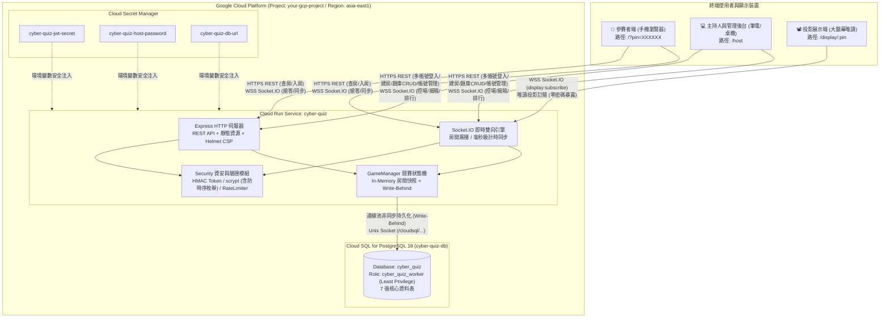
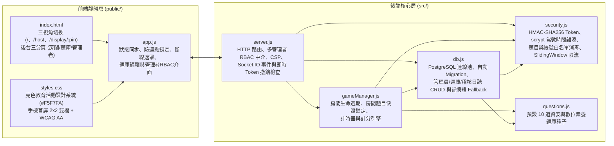
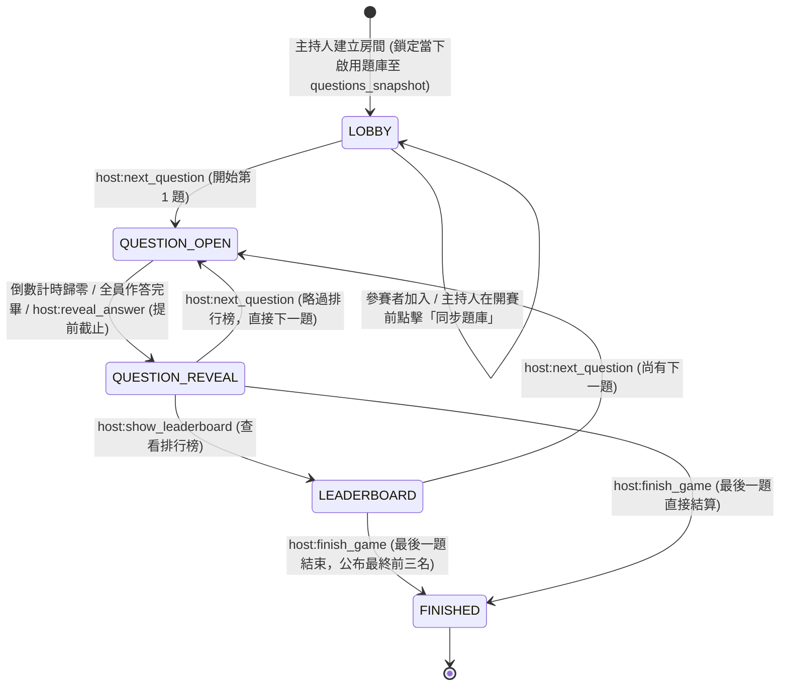
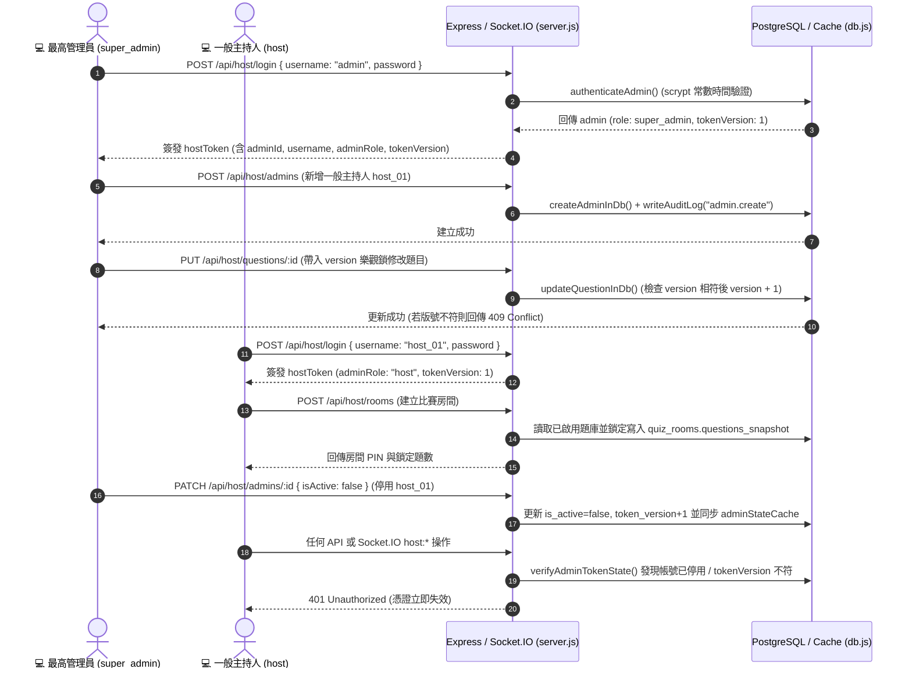
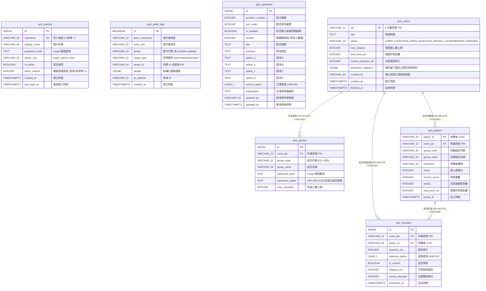

# CyberQuiz Arena (神手速快問快答大亂鬥) — 系統架構設計文件

> [!NOTE]
> **文件版本**：v2.1.0（含多管理者 RBAC、後台題庫 CRUD、單題最高分 MVP、房間題目快照與稽核日誌）  
> **生產環境網址**：`https://<your-cloud-run-service>.asia-east1.run.app`  
> **部署平台**：Google Cloud Run (`asia-east1`) + Cloud SQL for PostgreSQL 18 (`<your-cloudsql-instance>` / `cyber_quiz`)

---

## 1. 系統全景架構圖 (System Context & Cloud Topology)

系統採用單體式即時雙向架構（Node.js + Express + Socket.IO），部署於 Google Cloud Run，並透過 Unix Domain Socket 連接 Cloud SQL PostgreSQL 18。針對現場競賽高併發需求，由 [`GameManager`](../src/gameManager.js) 在記憶體維護毫秒級計時與即時狀態，並以 Write-Behind 非同步寫入 PostgreSQL 確保資料持久化。

---

## 2. 模組職責與檔案結構 (Component Architecture)

| 檔案路徑 | 核心職責說明 |
| :--- | :--- |
| [`src/server.js`](../src/server.js) | Express 與 Socket.IO 入口；設定嚴格 Helmet CSP、雙層登入限流（IP + 帳號）、`/api/host/*` RBAC 路由（`super_admin` 與 `host`）、以及每次操作強制執行的 `verifyHostAccess` 即時撤銷檢查。 |
| [`src/gameManager.js`](../src/gameManager.js) | 核心競賽狀態機；建房時將啟用題庫深拷貝鎖定至 `room.questions`（題目快照），負責房間建立、組別密碼驗證、雙層人數上限、倒數計時與個人/組別排行榜計算。 |
| [`src/security.js`](../src/security.js) | 實作 HMAC-SHA256 Token、具備 `DUMMY_SCRYPT_HASH` 防時序枚舉的 `scrypt` 密碼驗證、題目與帳號白名單驗證、以及滑動視窗防暴力破解限流器。 |
| [`src/db.js`](../src/db.js) | 管理 PostgreSQL 連線池、Schema 自動遷移、預設管理員初始化（`ensureBootstrapAdmin`）、`adminStateCache` 即時憑證狀態快取、題庫樂觀鎖 CRUD 與稽核日誌寫入。 |
| [`src/questions.js`](../src/questions.js) | 內建 10 道台灣個資法、著作權法與 AI 倫理情境題，僅於資料庫題庫為空時自動寫入種子資料。 |
| [`public/index.html`](../public/index.html) | 單頁式三視角結構：參賽者介面（`/`）、主持人與後台管理中心（`/host`，含「房間管理」、「題庫管理」、「管理者與日誌」三分頁）、唯讀投影頁（`/display/:pin`）。 |
| [`public/styles.css`](../public/styles.css) | 亮色教育活動設計系統（`#F5F7FA` 背景、`#FFFFFF` 表面、`#2457D6` 主色），確保手機首屏 2×2 答題不捲動與鍵盤 `:focus-visible` 無障礙支援。 |
| [`public/app.js`](../public/app.js) | 前端狀態管理、伺服器時鐘偏移校正（`serverClockOffsetMs`）、防連點鎖定、題庫新增/編輯/排序/匯入匯出、以及管理者帳號與稽核日誌管理。 |

---

## 3. 競賽狀態機與房間題目快照 (Game State Machine & Snapshot Isolation)

每個房間在建立時會將當下已啟用的中央題庫鎖定為房間專屬快照（`questions_snapshot`），確保比賽進行中即使後台修改題庫，也不會影響進行中的房間：

### 階段權限與防作弊保護規則
1. **`LOBBY`（等待室）**：參賽者驗證組別密碼加入；主持人可在開賽前點擊「同步題庫」更新房間快照。
2. **`QUESTION_OPEN`（作答進行中）**：
   - 後端 [`buildPublicState`](../src/gameManager.js#L622-L675) **強制濾除 `answer` 與 `explanation` 欄位**，前端無法從封包偷看答案。
   - 參賽者送出答案後，僅回傳 `acceptedOption` 與 `elapsedMs`，**揭曉前絕不提前透露對錯或加分**。
   - 狀態機鎖定防連點：在 `QUESTION_OPEN` 階段再次觸發 `host:next_question` 會直接拒絕，避免主持人誤觸跳題。
3. **`QUESTION_REVEAL`（答案揭曉）**：結算本題得分與各選項作答分布（A/B/C/D 人數與百分比），並公開正確答案與法規解析。
4. **`LEADERBOARD`（中場排行榜）**：計算個人前 10 名與組別平均分排行。
5. **`FINISHED`（最終頒獎與完整解析）**：顯示前三名頒獎台、匯出成績 CSV，並向參賽者開放全題目完整解析回顧。

---

## 4. 多管理者 RBAC、認證與題庫管理流程 (Multi-Admin RBAC & Question Bank Flow)

---

## 5. 資料庫 Schema 設計 (Database ER Diagram)

資料庫名稱為 `cyber_quiz`，共包含 7 張資料表，應用程式透過最小權限帳號 `cyber_quiz_worker` 進行存取：

---

## 6. 計分公式與排行榜排序演算法 (Scoring & Ranking Rules)

### 單題得分公式（僅答對者計分）
$$\text{Points} = 500 + \text{round}\left(500 \times \left(1 - \frac{\min(\text{elapsedMs}, \text{durationMs})}{\text{durationMs}}\right)\right) + \text{StreakBonus}$$

- **基礎分**：答對即得 `500` 分。
- **速度加成**：依剩餘時間比例線性加分，最高 `500` 分（0 秒瞬間作答得 500 分，壓線作答得 0 分）。
- **連續答對獎勵 (`StreakBonus`)**：
  - 連續答對第 2 題：`+100` 分
  - 連續答對第 3 題：`+200` 分
  - 連續答對第 4 題（含）以上：每題固定 `+300` 分（上限）

### 排序優先序
1. **個人排行榜 (`leaderboard`)**：
   - 第一優先：**個人總分 (`score`)** 由高至低
   - 第二優先（同分比序）：**答對題數 (`correctCount`)** 由多至少
   - 第三優先（再同分比序）：**累積總作答時間 (`totalTimeMs`)** 由短至長
2. **組別排行榜 (`groupLeaderboard`)**：
   - 第一優先：**組別平均分 (`avgScore = round(totalScore / memberCount)`)** 由高至低
   - 第二優先（同分比序）：**組別總分 (`totalScore`)** 由高至低
   - 第三優先：**答對總題數 (`totalCorrect`)** 由多至少

---

## 7. 資安防護縱深總覽 (Security Defense-in-Depth)

| 防護面向 | 實作機制與程式碼位置 |
| :--- | :--- |
| **Production Fail-Closed** | [`server.js`](../src/server.js#L43-L46) 與 [`security.js`](../src/security.js#L15-L21) 在 `NODE_ENV=production` 時強制要求設定 `HOST_PASSWORD` 與 `JWT_SECRET`，否則拒絕啟動。 |
| **防時序枚舉與雙層防暴力破解** | [`security.js`](../src/security.js#L98-L132) 於帳號不存在時仍執行 `DUMMY_SCRYPT_HASH` 常數時間比對；`/api/host/login` 同時對「來源 IP」與「目標帳號」進行獨立滑動視窗限流。 |
| **即時憑證撤銷 (`token_version`)** | 停用管理員或重設密碼時，`token_version` 立即遞增並同步至 `adminStateCache`，所有 HTTP API 與 Socket.IO `host:*` 事件透過 `verifyHostAccess` 即時攔截失效 Token。 |
| **題庫樂觀鎖與白名單消毒** | [`validateAndSanitizeQuestion`](../src/security.js#L171-L250) 過濾控制字元、檢查長度並禁止重複選項；編輯題目時強制比對 `version` 防止多人同時覆蓋（`409 Conflict`）。 |
| **嚴格 CSP 與防 XSS** | [`server.js`](../src/server.js#L81-L97) 啟用 `script-src 'self'`、`script-src-attr 'none'`、`connect-src 'self'`；前端 DOM 渲染全面使用 `textContent`。 |
| **防投影洩密保護** | 拆分獨立 `/display/:pin` 唯讀投影路由（後端不傳送 `hostGroups` 密碼，前端隱藏所有管理控制鈕），並在 `/host` 提供「投影模式」安全開關。 |
| **資料庫最小權限** | Cloud Run 透過專用角色 `cyber_quiz_worker` 連線，僅具備 7 張業務資料表與序列之 CRUD 權限，無 `SUPERUSER` 或跨資料庫權限。 |
