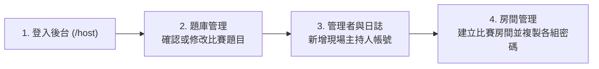

# CyberQuiz Arena（神手速快問快答大亂鬥）— 主持人與後台操作教學

這份文件提供活動主持人、控台助教與題庫管理同仁快速上手使用。

---

## 一、系統網址與登入資訊

| 用途 | 網址 / 說明 |
| :--- | :--- |
| **參賽者答題入口（手機）** | `https://<your-cloud-run-service>.asia-east1.run.app` |
| **主持人後台入口（筆電／控台）** | `https://<your-cloud-run-service>.asia-east1.run.app/host` |
| **大銀幕唯讀展示頁（投影幕）** | `https://<your-cloud-run-service>.asia-east1.run.app/display/房間PIN碼` |

### 管理員登入帳密
- **預設最高管理員帳號**：`admin`（或使用個人專屬帳號，如 `host01`）
- **管理密碼**：`（請輸入配發之個人密碼，或向系統管理員私下索取）`

> [!TIP]
> 登入後可至**「管理者與日誌」**分頁，為每位活動主持人或助教建立各自的獨立帳號。

---

## 二、活動前準備 SOP（題庫與帳號設定）

登入後台（`/host`）後，上方有三個管理分頁：

### 1. 修改或確認題目（分頁：「題庫管理」）
- **新增／編輯題目**：點選右上角 **「新增題目」** 或各題右側的 **「編輯」**，即可設定題目標題、情境描述、A/B/C/D 四個選項、正確答案與法規解析。
- **調整出題順序**：點擊題號旁的 **`↑`**、**`↓`** 按鈕即可即時調整題目順序。
- **暫時停用題目**：若某題本次活動不出，點選 **「停用」** 即可（不會被刪除，下次可再啟用）。
- **批次備份與匯入**：可點選 **「匯出題庫 JSON」** 備份目前題目，或用 **「匯入題庫 JSON」** 批次替換題庫；若想恢復系統內建題目，點選 **「還原預設 10 題」**。
- **安全隔離機制**：**比賽房間建立當下即會鎖定題目快照**。若同時有另一場比賽正在進行中，您在後台改題目**不會**影響正在比賽的房間。

### 2. 建立同事的專屬帳號（分頁：「管理者與日誌」）
- 點選右上角 **「新增管理者」**，可選擇兩種角色：
  - **一般主持人 (`host`)**：可建立與控制比賽房間、查看組別密碼、匯出成績、唯讀檢視題庫（適合現場控台人員，避免誤改題目）。
  - **最高管理員 (`super_admin`)**：除主持比賽外，可編輯題庫與管理所有帳號。
- 若同仁忘記密碼或活動結束需收回權限，點選 **「編輯／重設密碼」** 或 **「停用帳號」**，該帳號的既有連線會**立即失效**。

---

## 三、開房與發放各組密碼 SOP

1. 切換至 **「房間管理」** 分頁：
   - **房間名稱**：輸入本次活動名稱（例如：`神手速快問快答大亂鬥`）。
   - **人數上限**：設定全場總人數上限（預設 `100` 人）。
   - **每題作答時間（秒）**：設定每題倒數秒數（預設 `25` 秒）。
2. 設定 **「組別設定」**：
   - 輸入本次活動的 **「組數」** 與 **「每組人數上限」**，點選 **「調整組數與上限」**（系統會自動產生各組專屬密碼，也可直接在表格內手動修改組名與密碼）。
   - **批次匯入組別清單**：若已有現成 Excel／CSV 組別與密碼名單，可直接點選 **「匯入組別清單 (CSV／JSON)」** 一鍵帶入（亦可先點 **「匯出組別 CSV」** 下載範本修改）。
3. 點選最下方 **「建立房間」**，系統會產生一組 **6 位數房間 PIN 碼** 並進入等待室（等待室與大銀幕展示頁會自動產生該房間專屬的 **入場 QR Code**）。
4. **發放密碼給各組**：
   - 在控台上方點選 **「查看密碼」**。
   - 可點選各組右側的 **「複製此組」**（內含該組專屬快速連結、PIN 碼與組別密碼），直接貼給各組組長或助教；或點 **「複製全部」** 留存備查。

---

## 四、現場投影與控場流程 SOP（重要！）

### 1. 大銀幕投影防洩密設定（二選一）
為了避免在大銀幕上操作時讓參賽者看到組別密碼或後台設定，請使用以下任一方式：
- **方式 A（推薦：雙螢幕延伸桌面）**：
  - 筆電主畫面留在 `/host` 控台。
  - 點選控台上方的 **「開啟展示頁」** 按鈕，會自動開啟唯讀的 `/display/PIN碼` 視窗，將該視窗拉到投影機大銀幕全螢幕顯示（此畫面完全沒有密碼與管理按鈕，且會隨控台自動同步題目、倒數與排行榜）。
- **方式 B（單一螢幕鏡像投影）**：
  - 點選控台上方的 **「投影模式」** 按鈕，畫面會自動隱藏後台管理與踢人按鈕，並對「查看密碼」加上防誤觸保護。

### 2. 多人協同控場（主講人 + 控台助教）
- 台上主講人與台下控台助教可以各自登入 `/host`。
- 在 **「房間管理」** 分頁上方的 **「目前進行中／待命房間」** 區塊，直接點選該房間的 **「進入控場」**（或輸入 6 位數 PIN 點選「重連房間」），兩邊畫面與按鈕狀態會即時同步。

### 3. 測驗進行步驟
1. **等待室 (`尚未開始`)**：確認各組人數到齊後，點選藍色主按鈕 **「開始第一題」**。
2. **作答進行中**：
   - 參賽者手機會出現 2×2 四色幾何按鈕搶答（越快答對分數越高，連續答對另有加成）。
   - 當所有人作答完畢或倒數歸零時，系統會**自動揭曉答案**；若需提前結束本題，可點選 **「提前截止」**。
3. **答案揭曉**：
   - 畫面會顯示各選項作答人數比例、正確答案與法規解析，供主講人現場講解。
   - 講解完畢後，可點選 **「查看排行榜」** 顯示目前個人前 10 名與組別平均分排名；若想加快節奏，也可點選 **「略過排行榜，直接下一題」**。
4. **排行榜與下一題**：
   - 看完排行榜後，點選 **「開始下一題」** 進入下一題。
5. **最終結算與匯出成績**：
   - 最後一題結束後，點選 **「結束比賽」**，畫面將公布最終個人前三名頒獎台與組別總排名，參賽者手機也會解鎖完整題目與解析回顧。
   - 點選 **「匯出成績」** 即可下載全場個人與組別成績 CSV 報表（支援 Excel 直接開啟）。

---

## 五、現場常見問題快速排解 (FAQ)

| 現場狀況 | 處理方式 |
| :--- | :--- |
| **已經開好房間（還在等待室），但剛才去後台改了題目，怎麼讓這間房吃到新題目？** | 在房間等待室（尚未開始第一題前），點選控台上方的 **「同步題庫」** 按鈕，即可將本房題目更新為最新啟用題庫。 |
| **有參賽者選錯組別、把組別名額佔滿，或輸入不當暱稱怎麼辦？** | 在控台的參賽者列表或排行榜右側，點選該名參賽者的 **「更多操作」→「移除參賽者」**，移除後會立即釋放該組名額，讓正確的人加入。 |
| **參賽者手機不小心關掉網頁或網路瞬斷怎麼辦？** | 請參賽者用原本的瀏覽器重新打開網址，系統會**自動重連並恢復原本的分數與作答狀態**，不需重新輸入密碼。 |
| **某組因為連續輸錯組別密碼超過 12 次被暫時鎖定怎麼辦？** | 系統有防暴力猜測機制，請該組參賽者靜候 **1 分鐘** 後再輸入正確組別密碼即可。 |
